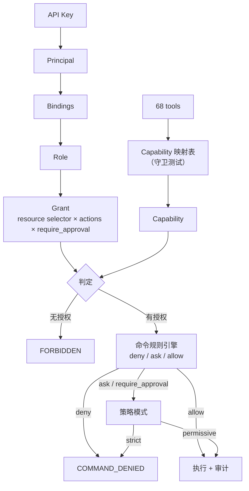

# clum 权限模型设计：从「主机分组」到「主体 × 角色 × 能力」

> **2026-10 变更**：审批运行时（elicitation / `approval_id` / server CLI）已移除；
> 全文涉及审批的描述（§4.4、§5、§6、§10、§11、§13、§15）均为历史记录，当前语义见 §6.3。
>
> 状态：**P0/P1/P2 已实施（2026-10-20）**。P1：elicitation、HTTP `/recordings`
> capability、无 host 工具 role-selector 过滤。P2：`command:read` 只读执行。
> CLI relay 与 labels 选择器已在 P0 落地。
> 本文同时保留设计与实施记录（见 §15）。
> **后续完整方案（覆盖全权限模型与路线图）见
> [`clum-docs/authorization-model.md`](authorization-model.md)；本文作为历史设计与 P0 实施记录保留。**
> 日期：2026-10-19
> 范围：`clum-mcp`（认证/授权/审批）、`clum-core`（共享错误码）、`clum-docs`（文档同步）
> 原则：默认拒绝；权限判定先于命令内容过滤；管理员不得自我提权；所有授权决策可审计。

---

## 1. 背景

clum 的定位是「让 AI 安全、可靠地操作远程终端」（README.zh.md），AI Agent 通过 MCP 自主接管操作，人类 CLI 是可选的介入通道。因此权限模型必须满足：

- **agent-first**：日常操作由策略自动判定，不依赖人类逐条确认；
- **可审计**：谁、用什么主体、依据哪条授权、做了什么；
- **可收敛**：管理员可以全权操作，但提权动作必须与审批主体分离。

当前实现只有一个维度：

```text
API key → { name, group }
host    → { group }
允许 ⇔ key.group == host.group（无组 key 视为 superadmin）
```

代码位置：`crates/clum-mcp/src/api_keys.rs`（`AgentIdentity`）、`crates/clum-mcp/src/tools/mod.rs`（`authorize`）。

### 1.1 当前模型的问题

| 问题 | 影响 |
|---|---|
| 只有 group 一个维度 | 同组内所有 key 等价：只读 agent 与能 `deploy_bridge` 的 agent 无法区分 |
| 无工具级权限 | 68 个工具共用同一判定；`host_list` 与 `kill_session` 没有区别 |
| 无资源标签 | 不能按 `env=prod`、`team=…`、host tags 授权 |
| 管理能力硬编码 | `reload_config` / `host_set_meta` 仅限「无组」key，无法委派 |
| 审批与权限脱节 | 审批只由命令规则 `ask` 触发，无法表达「该主体的写操作必须批准」 |
| CLI relay 只校验 group | 角色化后会成为最大绕过面 |

---

## 2. 目标与非目标

### 目标

1. 主体（api_key）可以绑定多个角色；角色由「资源选择器 × 能力」授权组成。
2. 默认拒绝；没有任何授权的主体不能调用任何工具。
3. 工具通过一张**受测试保护的映射表**落到能力（capability），新增工具漏映射时测试失败。
4. ~~审批以 **MCP elicitation** 为主~~（2026-10 移除）：当前由 `command_policy` 决定 `ask` 的语义——permissive 放行、strict 拒绝；无人工审批通道。
5. 策略存储在 SQLite（与审计同库），通过 server CLI 管理，不再新增配置文件。
6. 管理员可全权操作，但 `policy:write` 与 agent 运行时能力分离，且禁止自我提权。

### 非目标（本设计明确不做）

- 不做 Web/IM 审批入口（elicitation 已覆盖）。
- 不做 approver agent / quorum / 双人复核。
- 不做 JIT / 时间窗 / MFA / OIDC。
- 不做策略版本回滚（保留审计记录即可）。
- 不做任意条件表达式（仅 `require_approval` 布尔）。
- 不新增 MCP 工具（工具面维持 68 个）。

---

## 3. 术语

| 术语 | 含义 |
|---|---|
| Principal | 认证主体。当前只有 API key（agent / 管理员）；人类通过 elicitation UI 参与审批 |
| Role | 一组 Grant 的命名集合 |
| Grant | `resource_type × selector × actions × require_approval` |
| Capability | 稳定能力动词，如 `command:exec`、`file:write`、`approval:decide` |
| Selector | 资源选择器：host group / labels / name glob |
| Elicitation | **历史（2026-10 移除）**：MCP 协议中 server 主动请求客户端 UI 的能力，已不再用于审批 |

---

## 4. 业界参考（已核对官方文档）

| 系统 | 模型 | 借鉴点 |
|---|---|---|
| Teleport | User → Roles；allow/deny rules（resources × verbs），labels 选择资源；access requests | 默认拒绝；labels 选择器；审批作为独立提权流程 |
| HashiCorp Boundary | Principal → Role → grant strings（ids/type/actions）；allow-only；scopes | 能力动词 + 资源选择器；allow-only 简单可审计 |
| Kubernetes RBAC | Role/ClusterRole + verbs + resources + bindings | 工具/资源/动作三维绑定 |
| JumpServer | 资产授权 + 命令过滤 + 工单审批 | 权限与命令过滤分层 |

共同点：认证、授权、资源选择、动作、审批是五件分开建模的事。clum 的差异是「工具面固定 + 命令内容另有规则引擎」。

---

## 5. 目标模型



### 5.1 内置角色（第一版只需要三个）

| Role | 能力 | 说明 |
|---|---|---|
| `admin` | 全部业务能力 + `policy:write` + `config:reload` + `host:admin` + `deploy:bridge` | **不含** `approval:decide` |
| `operator` | 按 group/labels 授予的读、会话、命令、文件、转发能力 | 默认不带管理能力 |
| `readonly` | 读能力（host/session/terminal/recording/audit） | 审计、排障 |

审批运行时已移除，不存在 `approval:decide`；API key 不持有任何批准能力。

### 5.2 能力清单

| Capability | 含义 |
|---|---|
| `host:read` | 发现/查看主机、会话、pane、window |
| `host:admin` | 修改主机元数据（`host_set_meta`） |
| `session:create` | 创建会话/pane/窗口、拆分、移动、交换 |
| `session:attach` | attach / stream |
| `session:read` | 读取会话元数据/历史（CLI `term` relay 需要） |
| `session:kill` | 关闭 pane/window、杀会话 |
| `session:write` | resize、rename、select、layout、set title |
| `terminal:read` | 读取终端内容、等待、查找 |
| `terminal:input` | 注入按键/文本/粘贴 |
| `terminal:manage` | 清历史、缓冲区管理 |
| `command:exec` | 执行命令/进程 |
| `file:read` / `file:write` | 下载 / 上传 |
| `forward:read` / `forward:create` / `forward:delete` | 端口转发 |
| `recording:read` | 列表/读取/搜索录制 |
| `audit:read` | 查询审计 |
| `deploy:bridge` | 部署/升级 bridge |
| `config:reload` | 重载配置 |
| `policy:write` | 修改角色/授权/绑定（仅 server CLI） |
| `usage:read` | 读取 `clum_usage_rules` 使用说明 |

### 5.3 工具 → capability 映射（68 个，完整清单）

> 该表必须与 `schema.rs` 的工具清单保持一一对应；实施时增加守卫测试：**任一工具没有映射即测试失败**。

| Capability | 工具 |
|---|---|
| `host:read` | `host_list`, `host_filter`, `host_capabilities`, `find_sessions`, `find_panes`, `session_list`, `pane_info`, `window_info`, `pane_exists`, `list_window_panes`, `get_pane_title`, `get_pane_by_title` |
| `host:admin` | `host_set_meta` |
| `session:create` | `session_create`, `split_window`, `split_pane`, `split_pane_with`, `break_pane`, `join_pane`, `swap_pane` |
| `session:attach` | `session_attach`, `stream_pane` |
| `session:kill` | `close_pane`, `close_window`, `kill_session` |
| `session:write` | `resize_pane`, `resize_window`, `rename_window`, `select_window`, `select_layout`, `set_pane_title` |
| `terminal:read` | `capture_pane`, `capture_region`, `wait_for_text`, `wait_stable`, `wait_exit`, `wait_for_bytes`, `find_pane_text`, `find_text_all`, `collect_until_exit` |
| `terminal:input` | `send_keys`, `send_text`, `broadcast_keys`, `batch_send_keys`, `paste_buffer` |
| `terminal:manage` | `clear_history`, `list_buffers`, `delete_buffer` |
| `command:exec` | `exec`, `shell_command`, `batch_exec`, `cmd_escape`, `respawn_pane` |
| `file:read` | `file_download`, `batch_download` |
| `file:write` | `file_upload`, `batch_upload` |
| `forward:read` | `forward_list` |
| `forward:create` | `forward_create` |
| `forward:delete` | `forward_close` |
| `recording:read` | `list_recordings`, `get_recording`, `search_recordings` |
| `audit:read` | `audit_query`, `query_bridge_audit` |
| `deploy:bridge` | `deploy_bridge` |
| `config:reload` | `reload_config` |
| `usage:read` | `clum_usage_rules` |

---

## 6. 判定管线

```text
1. authenticate()
     API key → principal（name + group）
2. capability_check()          # 默认拒绝
     bindings(principal) → roles → grants
     selector 匹配 resource（host group / labels / name）
     tool → capability ∈ actions
3. command_rule_engine()       # 仅命令类工具（10 个）
     deny > ask > allow；hazard 升格
4. command policy
     permissive: ask / require_approval → allow
     strict: ask / require_approval → deny
5. execute + audit
```

关键顺序：**能力判定先于命令解析**。没有 `command:exec` 的主体不会进入命令规则引擎。

### 6.1 审批：elicitation 为主（历史，2026-10 已移除）

> **实施状态**：已移除。本节仅保留设计记录；当前语义见 §6.3。
> 审批运行时（elicitation、`approval_id`、server CLI）已删除，`ask` 由 `command_policy`
> 决定：permissive 放行，strict 拒绝。

实施前提（已核实）：

- `rmcp = 3.0.0` 提供 server 侧 elicitation API；项目已启用 `elicitation` feature；
- OpenCode 的 MCP client 已实现 elicitation form（`packages/core/src/mcp/index.ts`，外部实现，非本项目保证）。

流程：

```text
ask 命中
  → 若客户端在 initialize 时声明 elicitation 能力：
       server 发送 ElicitRequest（message 含主机/工具/命令/规则/风险）
       → 客户端弹框
       → Accept: 同一次调用继续执行（不产生 approval_id）
       → Decline: 返回 COMMAND_DENIED
       → 超时（默认 120s）: 回退到 APPROVAL_REQUIRED
  → 否则：返回 APPROVAL_REQUIRED + approval_id（现有流程）
```

审计：

- `ApprovalDecided` detail 记录 `elicitation accepted/declined`、命令、规则、主机；
- 回退路径仍写 `ApprovalRequested` + pending。

实现改动点（P1）：

- `Cargo.toml`：rmcp features 已增加 `elicitation`；
- `progress.rs`：`ProgressReporter` 持有 per-request `Peer`，提供 `supports_elicitation` / `elicit`（120s 超时）；
- `tools/mod.rs`：`ask` 分支优先 elicitation；Decline/Cancel → `COMMAND_DENIED`；超时/不支持回退；
- stdio 自定义 JSON-RPC 没有 rmcp `Peer`，自动回退。

### 6.2 CLI relay 的 capability 映射（已定）

CLI relay 是字节流，无法逐命令裁决；在**连接建立时**按 `purpose` 做一次 capability 判定，即可消除「完全绕过」：

| CLI purpose | 所需 capability |
|---|---|
| `term` | `session:attach` + `terminal:input` + `session:read` |
| `forward` | `forward:create` |
| `push` | `file:write` |
| `pull` | `file:read` |
| `list` | `host:read` |
| `replay` | `recording:read`（**注**：`clum-cli replay` 实际走 HTTPS `/recordings` 下载，不在 QUIC relay 路径；见下） |

实现位置：`quic_server.rs::handle_agent_connection` 认证后，调用与 MCP 共用的 `capability_check(principal, purpose_capability, target_host)`。目标 host 必须落在 grant 的 selector 内。

**replay 的实际落点**：`clum-cli replay` 用 HTTPS `GET /recordings/<path>` + Bearer 下载（`clum-cli/src/main.rs`），认证在 `http_server` 的 API-key 中间件。现在按路径首段 host + `recording:read` capability + selector 判定，与 MCP `get_recording` 一致；legacy 有组 key 只能下载同组录制。

**审批语义**：relay 是无人在环的字节流，无法执行 `require_approval`。若命中的 grant 要求审批，relay 连接直接 fail-closed 拒绝，并提示改用 MCP 工具；不会静默绕过审批。

### 6.3 命令策略模式（2026-10）

审批运行时已移除：`approvals` 模块、`clum-mcp approval` CLI、MCP elicitation、`approval_id` 参数、`pending_approvals` 写入。原因：主流 MCP 客户端（OMP、VS Code 等）未声明 elicitation 能力，唯一可行路径退化为「人登录 server 执行 CLI」，违背「agent 操作、人只对话」的产品前提。

两种模式（`server-config.yaml: command_policy`，启动时读取；变更需重启，规则/KB 仍可 `reload_config` 热重载）：

| 模式 | Ask 语义 | 人工确认 |
|---|---|---|
| `permissive`（默认） | 视为 Allow | 无 |
| `strict` | 视为 Deny（fail-closed） | 无 |

边界与已知局限：

- 破坏性命令由 `config/command-rules.toml` 的显式 deny 规则拦截：rm 关键路径、dd 块设备、mkfs/分区、关机、清防火墙、杀 init、解释器/xargs 包装。
- 命令字符串规则**不是安全边界**：变量拼接、脚本文件、base64、`bash -c "$X"` 可绕过；它只防误操作与模型幻觉。
- 真正的边界：agent 的 API key 不含 `host:admin` / `config:reload` / `policy:write`；clum-mcp server 主机不在 agent 的 selector 内；agent 不以 root 运行（主机侧约束）。
- 知识库 effect 分类在 permissive 下失效，保留 `read_only` 标注供 `command:read`。
- 审计枚举 `ApprovalRequested` / `ApprovalDecided` 与错误码 `APPROVAL_REQUIRED` / `APPROVAL_INVALID` 仅作历史兼容，不再产生。

**6.2 的边界（明确保留）：**

- relay 内部不再做命令内容裁决（字节流不可解析）；
- 审计记录 `purpose`、host、session、时长与结果；不记录逐命令；
- 这是「权限收敛」，不是「命令闸门」；命令闸门仍只覆盖 10 个 MCP 工具。

---

## 7. 数据模型（SQLite，与审计同库）

```sql
CREATE TABLE principals (
  id         TEXT PRIMARY KEY,
  kind       TEXT NOT NULL,              -- api_key
  name       TEXT NOT NULL UNIQUE,
  status     TEXT NOT NULL DEFAULT 'active',
  created_at TEXT NOT NULL
);

CREATE TABLE roles (
  id         TEXT PRIMARY KEY,
  name       TEXT NOT NULL UNIQUE,       -- admin / operator / readonly / legacy-group:*
  builtin    INTEGER NOT NULL DEFAULT 0,
  created_at TEXT NOT NULL
);

CREATE TABLE grants (
  id               TEXT PRIMARY KEY,
  role_id          TEXT NOT NULL REFERENCES roles(id) ON DELETE CASCADE,
  resource_type    TEXT NOT NULL,        -- host / command / file / session / recording / audit / policy
  selector_json    TEXT NOT NULL,        -- {"group":["dev"]} | {"labels":{"env":"prod"}} | {"name":"tf*"}
  actions_json     TEXT NOT NULL,        -- ["command:exec","terminal:input"]
  require_approval INTEGER NOT NULL DEFAULT 0
);

CREATE TABLE bindings (
  principal_id TEXT NOT NULL REFERENCES principals(id) ON DELETE CASCADE,
  role_id      TEXT NOT NULL REFERENCES roles(id) ON DELETE CASCADE,
  PRIMARY KEY (principal_id, role_id)
);
```

- 策略快照缓存在 server 内存；变更由 CLI 写库并 bump `policy_revision`；
- 加载/解析失败保留旧快照（fail-closed，不退化为「无权限」或「全权限」）；
- 策略变更写现有审计哈希链（`action=ConfigReload`，detail 记变更摘要）。

---

## 8. 管理接口（server CLI）

不新增 MCP 工具；管理员在 **server 主机**上执行 CLI（agent 不应被授予执行这些命令的能力）：

```bash
clum-mcp role list
clum-mcp role grant operator --resource host --group dev \
        --actions host:read,session:create,session:attach,command:exec
clum-mcp role grant operator --resource command --group prod \
        --actions command:exec --require-approval
clum-mcp role bind --key agent-dev --role operator
clum-mcp role unbind --key agent-dev --role operator
clum-mcp policy explain --key agent-dev --tool exec --host tf001
```

约束：

- **P0 实际行为**：CLI 在 server 本机执行，无法可靠获知调用者 principal，因此写操作不做 principal 校验；信任边界是「server 主机 shell 访问权」。所有变更均写入审计哈希链（`action=ConfigReload`），detail 记录完整变更命令。
- **P1 实际**：`role grant/bind/unbind` 由 server 本机人类执行；CLI 是独立进程，不在 MCP 请求内，**无法 elicitation**。`role list` / `policy explain` 为只读。`admin` 角色不含 `approval:decide`。
- 不做 principal-aware 的 self-escalation 检测（原因同上）；安全性由「策略写需要 server 本机访问权 + 审计」保证。
- 不需要 server TTY 二次确认（已确认）。
- `--db` 可指定策略/审计库路径（默认 `~/.clum/audit.db`，与服务端 `--audit-db` 保持一致）。
- **全局能力必须用全局 grant**：`config:reload` / `policy:write` 没有目标主机，必须 `--all`；`--group/--labels/--name` 作用域的 grant 不能授权它们。
- **内置 grant 不可编辑**：迁移生成的 `builtin:*` grant（`admin` 全权、`legacy-*`）拒绝 `role grant` 改写；需要不同组合时给普通角色授权并绑定 key。
- legacy role（`legacy-superadmin` / `legacy-group:*`）整体不可编辑，由迁移维护。

---

## 9. 迁移（行为不变优先）

1. 启动时 migration：为每个现有 group 生成 `legacy-group:<g>`：
   - grants = 该 group 主机的当前等价能力集；
   - 不含 `policy:write` / `config:reload` / `host:admin`（保持现有 superadmin 限制）。
2. 无组 key 绑定 `legacy-superadmin`（当前行为）。
3. 现有 key 自动绑定 legacy role；**尚未 materialise 的 principal**（服务运行期间新建的 key）由 `legacy_fallback` 按旧 group 规则即时判定。
4. 已 materialise 的 principal 以绑定为准（空绑定 = 默认拒绝）；显式 `unbind` 不会在重启后被迁移重新绑定。
5. 未做新旧判定并行 shadow（P0 用 legacy fallback 达到等价，测试覆盖见 §11）；旧 `authorize` 分支已由 capability 判定替代。

---

## 10. 安全不变量

1. **默认拒绝**：没有任何 grant 的主体不能调用工具。
2. **能力先于命令解析**：无 `command:exec` 时不进入命令引擎。
3. **管理员不得自我提权**：`admin` 不含 `approval:decide`；策略写操作由「server 本机 shell 访问权 + 审计」约束。CLI 不在 MCP 会话内，无法 elicitation。
4. **审批只来自 elicitation 或 server CLI 的人类**：`approval:decide` 不授予任何 API key；agent 不能自主确认。
5. **策略加载失败保留旧快照**，绝不退化为全放行。
6. **工具映射完备**：68 个工具全部有 capability；新增工具漏映射时测试失败。
7. **审批失败 fail-closed**：elicitation 超时/拒绝/客户端不支持 → 不放行。
8. **所有决策可审计**：principal、role、grant、capability、approval source。

---

## 11. 测试计划

| 测试 | 期望 | 状态 |
|---|---|---|
| 工具映射完备性 | 68 个工具全部有 capability，漏一个失败 | ✅ `capability::tests` |
| legacy 等价性 | 旧 group key 在新旧判定下结果一致 | ✅ `policy::tests` + `tools::tests` |
| 默认拒绝 | 新 key 未绑定角色 → `FORBIDDEN` | ✅ `policy::tests` |
| 越权矩阵 | `readonly` 不能 exec；跨组不能 attach；`operator` 不能 `deploy_bridge` | ✅ selector/capability 单测 |
| 策略写确认 | `role grant/bind/unbind` 由本机 shell 访问权 + 审计约束；CLI 不经过 MCP | ✅（设计约束） |
| ~~审批条件~~（历史） | `require_approval` 现在只决定 `ask` 语义（permissive 放行 / strict 拒绝） | `escalate_to_ask` |
| ~~elicitation 降级~~（历史，2026-10 移除） | 审批运行时已删除 | — |
| 策略热重载 | 解析失败保留旧快照 | ✅ `policy::tests` |
| CLI relay | `term/push/forward/pull/list` 按 purpose 判定 capability；跨组拒绝 | ✅ `quic_server::purpose_capabilities` |
| replay 下载 | `clum-cli replay` 走 HTTPS `/recordings`，按 host + `recording:read` 判定 | ✅ |

---

## 12. 分阶段落地

| 阶段 | 内容 | 验收 | 状态 |
|---|---|---|---|
| **P0** | 4 张表（principals/roles/grants/bindings）+ legacy role + 68 工具 capability 映射 + `role grant/bind/unbind/list` + `policy explain` + 快照缓存 | 旧 key 行为零变化；映射守卫测试通过 | ✅ 2026-10-19 |
| **P1** | rmcp `elicitation`；`ask` 弹框；超时降级；HTTP `/recordings` capability；无 host 工具 role-selector 过滤 | 客户端点 Approve 后同一次调用执行；`/recordings` 与 MCP 一致 | ✅ 2026-10-20 |
| **P2** | CLI relay 按 purpose 纳入 capability；labels 选择器；`command:read` 只读执行 | CLI 不再完全绕过；只读矩阵通过 | ✅ 2026-10-20 |

---

## 13. 风险与开放问题

| 风险/问题 | 说明 | 处置 |
|---|---|---|
| ~~客户端不支持 elicitation~~（历史） | 审批运行时已移除 | 由 `command_policy` 取代 |
| 管理员 agent 被注入 | 可修改策略 | 策略写需要 server 本机 shell；`admin` 不用于 agent 运行时 |
| 策略写无调用者身份 | 本机 CLI 无法获知 principal，也不经过 MCP | 已知边界：信任边界是 server 本机 shell + 审计 |
| 策略存在 DB 的启动顺序 | 首次启动需要 bootstrap admin key | 保留 `server-config.yaml` 的 bootstrap 段 |
| CLI relay | 已按 purpose 在连接建立时判定 capability | 已收敛（§6.2） |
| 工具面冻结 | 不新增工具，管理走 CLI | 已确认 |

### 已确认决策（2026-10-19，2026-10-21 修订）

1. **无人工审批通道**（2026-10-21）：`ask` 由 `command_policy` 决定——permissive 放行、strict 拒绝；elicitation / `approval_id` / server CLI 已移除。
2. **策略写只受 server 本机 shell 访问权约束**；`admin` 不用于 agent 运行时。
3. **策略与审计同库**（`audit.db`），不拆独立 `policy.db`。
4. **CLI relay 按 purpose 纳入 capability**（见 §6.2）：连接建立时判定，relay 内不逐命令裁决。

---

## 14. 附：与现有机制的关系

| 现有机制 | 关系 |
|---|---|
| 旧 `authorize`（仅 group 隔离） | P0 后由 capability + selector 判定替代；legacy role 保持等价 |
| `command-rules.toml`（deny/allow） | 保留，位于 capability 之后；`ask` 由 `command_policy` 决定（permissive 放行 / strict 拒绝） |
| `command-kb.toml` | 保留，命令内容分类不进入权限模型 |
| `pending_approvals` | **历史（2026-10 移除）**：表结构保留兼容旧审计，不再读写 |
| 审计哈希链 | 策略变更与命令拒绝均写入 |
| 工具面 68 | 不新增；capability 映射是内部判定 |

---

## 15. P0 实施记录（2026-10-19）

### 15.1 代码位置

| 文件 | 内容 |
|---|---|
| `crates/clum-mcp/src/capability.rs` | 22 个 capability 动词；68 工具映射表；legacy/admin 能力集；守卫测试 |
| `crates/clum-mcp/src/policy.rs` | SQLite 四表、selector、快照、判定、迁移、热加载 |
| `crates/clum-mcp/src/policy_cli.rs` | `role list/grant/bind/unbind`、`policy explain`、变更审计 |
| `crates/clum-mcp/src/tools/mod.rs` | `authorize` 改为 capability 判定；`require_approval` 合并进审批流程 |
| `crates/clum-mcp/src/quic_server.rs` | CLI relay 按 purpose 在连接建立时判定 capability |
| `crates/clum-mcp/src/http_server.rs` | 每次 MCP 调用注入认证主体 `principal_name` |
| `crates/clum-mcp/src/main.rs` | 策略存储初始化、`role` / `policy` 子命令分发 |

### 15.2 数据表

与审计同库（默认 `~/.clum/audit.db`，`--db` / `--audit-db` 可覆盖）：

- `principals(id, kind, name UNIQUE, status, created_at)`
- `roles(id, name UNIQUE, builtin, created_at)`
- `grants(id, role_id, resource_type, selector_json, actions_json, require_approval)`
- `bindings(principal_id, role_id)`
- `policy_meta(key, value)`：`revision` 计数器，CLI 每次变更 +1；server 以 ≤1s 节流探测并热加载快照。

内置角色：`admin`（global + 全部能力，含 `policy:write`）、`operator` / `readonly`（空 grant，由管理员按 group/labels/name 授予）。迁移角色：`legacy-superadmin`、`legacy-group:<g>`（每次启动同步能力集，CLI 禁止修改）。

### 15.3 CLI 用法

```bash
# 查看角色/授权/绑定
clum-mcp role list [--db /root/.clum/audit.db]

# 授权（role 不存在时自动创建；--group/--labels/--name/--all 至少一个）
clum-mcp role grant operator --group dev \
  --actions host:read,session:attach,command:exec
clum-mcp role grant operator --labels env=prod --actions command:exec --require-approval
clum-mcp role grant readonly --name 'tf*' --actions host:read,terminal:read

# 绑定/解绑（key 必须已由 `agent add` 创建）
clum-mcp role bind --key agent-dev --role operator
clum-mcp role unbind --key agent-dev --role legacy-group:dev

# 解释一次判定
clum-mcp policy explain --key agent-dev --tool exec --host tf001 \
  [--hosts-file config/hosts.yaml] [--db /root/.clum/audit.db]
```

`policy explain` 输出 principal、key group、capability、host 元数据、ALLOW/DENY、approval、命中的 role/grant/selector 与拒绝原因。

### 15.4 行为与边界

- **旧 key 零变化**：已 materialise 的 key 绑定 legacy role；服务运行期间新建、尚未 materialise 的 key 走 `legacy_fallback`，复刻旧 group 规则（无组 = superadmin，有组 = 同组全工具、排除 `host_set_meta` / `reload_config`）。
- **默认拒绝**：一旦 principal 已 materialise，绑定即权威；空绑定 = 拒绝，显式 `unbind` 不会因重启被迁移恢复。
- **能力先于命令解析**：`authorize` 在规则引擎之前执行；跨组/缺能力的调用不会进入命令评估。
- **`require_approval`**：命中 grant 时把 `allow` 升级为 `ask`（`deny` 不变）；审批运行时已于 2026-10 移除，`ask` 由 `command_policy` 决定（permissive 放行 / strict 拒绝）。
- **热加载**：CLI 写库 bump revision；server 在工具调用/relay 连接时探测（1 秒节流）。快照解析失败保留旧快照并记录 error。
- **CLI relay**：`term → session:attach + terminal:input + session:read`、`forward → forward:create`、`push → file:write`、`pull → file:read`、`list → host:read`；未知 purpose 在认证模式下拒绝。relay 内仍不逐命令裁决。
- **replay**：`clum-cli replay` 不走 QUIC relay，而是 HTTPS `GET /recordings` + Bearer。`http_server` 现在按首段 host + `recording:read` + selector 判定，与 MCP 一致。
- **stdio / bootstrap**：无 API Key 认证的调用（stdio 模式、无 key 时的回环 bootstrap）跳过 capability 判定，保持原有 superadmin 语义。
- **全局能力必须用全局 grant**：`config:reload` / `policy:write` 没有目标主机，组/labels/name 作用域的 grant **不能**授权它们（判定时要求 selector 为 `all`）。否则 `role grant op --group prod --actions config:reload` 会把“prod 作用域”错当成全局授权。
- **无 host 参数的工具**：`host_list` / `host_filter` / `audit_query` / `list_recordings` / `get_recording` / `search_recordings` 通过 `allowed_host_names` 按 role selector 并集过滤；legacy principal 的结果与旧 group 规则一致。

### 15.5 验证

- `cargo test --workspace`：clum-mcp 300 passed；clum-command-kb 61 + e2e 6；rmux-bridge 93；clum-core 67；clum-cli 85 + 2；全部通过（613 项）。
- `cargo clippy --workspace --all-targets -- -D warnings`：无警告。
- 端到端（临时 DB + hosts.yaml）：迁移生成 `legacy-group:dev` 并绑定 `agent-dev`；`exec` 在 devhost ALLOW、prodhost DENY；`role grant --require-approval` 后 approval=true；显式 unbind 后 DENY；组作用域 `config:reload` DENY、全局 grant ALLOW；四次变更均写入 `audit_events`（`ConfigReload`）。
- **未执行**：远程主机/生产服务更新、真实 MCP 客户端的 elicitation 交互测试。

### 15.6 未实施项

- 无代码项。
- 策略写 elicitation 经评估不可行：CLI 是独立进程，不在 MCP 请求内；信任边界保持「server 本机 shell 访问权 + 审计」。
- 真实客户端的 elicitation 交互需要人工/集成测试，未包含在单元测试中。
