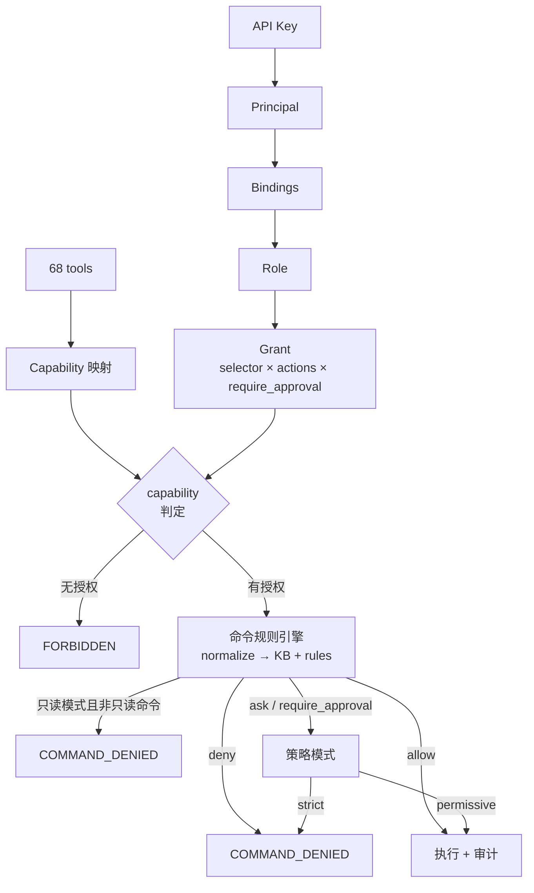

# clum 权限模型完整方案

> 状态：**P0/P1/P2 已实施（2026-10-20）**；P3 为提案。
> 本方案描述现状、目标模型与后续路线。
> 关系：`clum-docs/authorization-design.md` 是最初的设计与 P0 实施记录；本文是
> 结合项目理念与架构的**完整方案**，后续以本文为准。
> 原则：默认拒绝；能力先于命令解析；审批不能提权；所有决策可审计。

---

## 1. 现状与问题

### 1.1 已落地（P0）

| 能力 | 位置 |
|---|---|
| principal / role / grant / binding 四表，策略与审计同库 | `crates/clum-mcp/src/policy.rs` |
| 68 工具 → capability 映射，守卫测试 | `crates/clum-mcp/src/capability.rs` |
| capability + 资源选择器判定，先于命令规则引擎 | `tools/mod.rs::authorize` |
| legacy 迁移（`legacy-superadmin` / `legacy-group:*`），旧 key 行为不变 | `policy.rs::migrate_legacy` |
| 策略热加载（revision + ≤1s 节流），失败保留旧快照 | `policy.rs` |
| `role list/grant/bind/unbind`、`policy explain` | `policy_cli.rs` |
| CLI relay 按 purpose 判定 capability（term/forward/push/pull/list） | `quic_server.rs` |
| `require_approval` 升级为 `ask`（permissive 放行 / strict 拒绝） | `tools/mod.rs::escalate_to_ask` |
| 策略变更写入审计哈希链 | `policy_cli.rs` |
| ~~elicitation 审批~~（2026-10 移除） | — |
| HTTP `/recordings` 接入 `recording:read` + selector | `http_server.rs` 认证中间件 |
| 无 host 工具按 role selector 过滤 | `tools/mod.rs::allowed_host_names` |
| `command:read` 只读执行（白名单、默认拒绝） | `capability.rs` + `tools/mod.rs` + `clum-command-kb` |

### 1.2 仍缺 / 已知边界

| 缺口 | 影响 | 归属 |
|---|---|---|
| 策略写仍为 server 本机 CLI | CLI 不在 MCP 请求内，不经过命令规则引擎；信任边界是 shell 访问权 | 设计约束 |
| 命令分类依赖 KB 准确性 | `command:read` 只放行显式白名单，误判方向为拒绝 | 持续维护 |
| 审计写失败 fail-open | 审计不是强制门 | 已知债务 |
| 无人工审批通道 | permissive 放行 / strict 拒绝；命令规则仅作防误操作护栏 | 2026-10 决策 |

### 1.3 核心矛盾

clum 的 68 个工具里，`exec` / `batch_exec` 是通用外壳：同一个 capability 既能跑
`kubectl get pods`，也能跑 `rm -rf /`。capability 只能做到“工具级”，命令语义必须
交给 KB/规则。这不是实现错误，而是**工具面冻结 + 通用 exec** 的结构性结果。

---

## 2. 理念与架构约束

| 约束 | 对权限模型的含义 |
|---|---|
| **agent-first** | 日常操作由策略自动判定；只读、低风险命令不应逐条审批 |
| **人类可选介入** | 人类只在策略写时出现；命令执行无人工审批 |
| **双通道** | MCP 工具走完整判定；CLI relay 在连接建立时按 purpose 判定；两者共享 principal/policy |
| **工具面 68 冻结** | 不新增专用工具；新能力通过 capability 表达 |
| **默认拒绝** | 无匹配 grant → `FORBIDDEN`；未知命令 → permissive 放行 / strict 拒绝；只读未标记 → 拒绝 |
| **能力先于命令解析** | 没有 `command:exec`/`command:read` 的调用不会进入规则引擎 |
| **可审计** | principal、role、grant、capability、exec mode、command policy 全部入审计链 |
| **不是堡垒机** | 不承诺命令级强隔离；强隔离靠远端账号/沙箱（见 §13） |
| **central server + QUIC + bridge + rmux** | 授权在 server 侧完成；bridge 不参与策略判定；relay 无法逐命令裁决 |

---

## 3. 总体模型



三层职责：

| 层 | 回答的问题 | 失败方向 |
|---|---|---|
| capability + selector | 这个主体能不能用这个工具、对这台主机 | 默认拒绝 |
| 命令规则 + KB | 这条命令能不能跑 | permissive：仅显式 deny 拦截；strict：未知/解析失败/ask → 拒绝 |
| ~~审批~~（历史，2026-10 移除） | 无人工审批；`ask` 由 `command_policy` 决定 | permissive 放行 / strict 拒绝 |

---

## 4. 主体、角色、绑定

### 4.1 主体

当前只有 API key。`principals` 表保存稳定标识：

```text
principals(id, kind='api_key', name UNIQUE, status, created_at)
```

`ApiKeyStore` 负责认证；`PolicyStore` 负责授权。运行期新建、尚未 materialise 的 key
走 `legacy_fallback`，行为与旧 group 规则一致。

### 4.2 角色

| 角色 | 能力 | 说明 |
|---|---|---|
| `admin` | 全部 capability + `policy:write` | **不含** `approval:decide` |
| `operator` | 空 grant | 由管理员按 group/labels/name 授予 |
| `readonly` | 空 grant | 由管理员按资源授予读能力 |
| `legacy-superadmin` | 除 `policy:write` 外全部 | 无组旧 key |
| `legacy-group:<g>` | 同组业务能力，排除 `host:admin`/`config:reload`/`policy:write` | 有组旧 key |

多角色绑定取**并集**（allow-only）：任一 grant 匹配即允许；不存在跨角色的 deny。
命令层的 `deny` 仍然是否决。这个选择简单、可审计；需要“取交集/最严”时再引入
deny grant（当前不支持）。

### 4.3 绑定与默认拒绝

- 未 materialise 的 principal：`legacy_fallback`（兼容旧 key）。
- 已 materialise 且无绑定：**拒绝**。
- 显式 `unbind` 不会被重启迁移恢复。
- CLI `role bind` 要求 key 已由 `agent add` 创建。

---

## 5. 资源与选择器

`HostResource { name, group, labels }` 来自注册库（`bridge_store`）或 `hosts.yaml`。

```json
{"group": ["dev", "staging"]}
{"labels": {"env": "prod"}}
{"name": "tf*"}
{"all": true}
```

| 规则 | 行为 |
|---|---|
| 空 selector | 永不匹配（fail-closed） |
| `all: true` | 匹配任意主机；全局能力必须使用 |
| `group` | 主机有效 group 属于列表 |
| `labels` | 全部键值 AND |
| `name` | glob，非法模式按不匹配 |
| 无 host 上下文 | host-scoped grant 视为匹配，工具自身做结果过滤（已知残留） |
| 多主机 | 逐主机判定；任一拒绝即整体拒绝 |
| `config:reload` / `policy:write` | 无目标主机，必须 `all: true` |

`resource_type` 当前只记录语义（host/global/command/file/session/recording/audit/policy），
**判定只看 action + selector**；不要误以为 `resource_type=command` 有独立语义。

---

## 6. 能力与工具映射

### 6.1 能力清单

23 个能力（含已实施的 `command:read`）：

```text
host:read, host:admin,
session:create, session:attach, session:read, session:kill, session:write,
terminal:read, terminal:input, terminal:manage,
command:exec, command:read,
file:read, file:write,
forward:read, forward:create, forward:delete,
recording:read, audit:read,
deploy:bridge, config:reload, policy:write, usage:read
```

### 6.2 映射原则

1. 一个工具映射一个 capability；`exec` / `batch_exec` 例外（`command:exec` 或 `command:read`）。
2. 新增工具必须同步 `capability.rs`；守卫测试对比 `schema.rs`，漏映射即失败。
3. 能力字符串一旦发布不得重命名（策略行按字符串匹配）。
4. `shell_command`、`respawn_pane`、`split_pane_with`、`cmd_escape` 永远只接受
   `command:exec`——它们没有可静态判断的“只读执行”语义。
5. `send_keys` 族只接受 `terminal:input`，不属于 `command:read`。

### 6.3 只读执行（已实施）

`command:read` 已实施；完整设计见
`clum-docs/superpowers/plans/2026-10-20-command-read-capability.md`。要点：

- 只读模式只允许 `decision.read_only == true` 的命令；
- 默认拒绝，显式白名单，危险 flag/hazard 强制非只读；
- 规则 `allow` 不能提权；
- `sudo`/`doas` 前缀在 v1 视为非只读；
- 非只读命令直接 `COMMAND_DENIED`，不进入策略模式（审批不能提权）。

---

## 7. 判定管线

### 7.1 顺序

```text
1. authenticate
     API key → principal(name, group)
2. capability_check（默认拒绝）
     bindings → roles → grants
     selector.match(HostResource)
     tool → capability ∈ actions
     → Full / ReadOnly / FORBIDDEN
3. normalize payload
     send_keys 族统一解码（裁决 = 执行）
4. command_rule_engine（仅命令类工具）
     normalize → KB 分类 + 规则 deny/allow
     多主机取最严
5. read_only gate（仅 ReadOnly 模式）
     allow 且 read_only → 继续
     deny → 原 deny
     其余 → COMMAND_DENIED
6. command policy
     permissive（默认）→ Ask 视为 Allow
     strict → Ask 视为 Deny
     （审批通道已于 2026-10 移除，见 authorization-design.md §6.3）
7. execute + audit
```

### 7.2 错误码

| 场景 | error_code |
|---|---|
| 无 capability / selector 不匹配 | `FORBIDDEN` |
| 规则 deny | `COMMAND_DENIED` |
| 只读模式下的非只读命令 | `COMMAND_DENIED` |
| 规则 ask / require_approval（strict） | `COMMAND_DENIED` |
| ~~审批凭证无效~~ | **历史（2026-10 移除）** |
| 未知工具 | `INVALID_PARAMS`（rmcp unknown tool） |

消息必须包含 `not in your group` 或 `requires superadmin` 以保持分类器兼容
（`clum-core/error_code.rs`）。

### 7.3 多主机

- `batch_exec` / `batch_send_keys` / `batch_upload` / `batch_download`：解析 `hosts` 数组。
- capability 逐主机判定，任一失败 → 整体 `FORBIDDEN`。
- 命令规则逐主机组评估，取最严。
- 审批 scope 绑定排序去重后的主机集合。

---

## 8. 命令策略层

### 8.1 KB 三层

```text
generated.toml（safe-chains 1,586）
  ↓ 同名整条覆盖
commands.toml（人工收紧 144）
  ↓ 同名整条覆盖
config/command-kb.toml（运行时覆盖，reload_config 热加载）
```

三层合并去重后 **1,607** 条（由 `documented_entry_count_matches_builtin` 测试锁定）。

分类：`Inert/SafeRead → allow`、`SafeWrite → ask`、未知/解析失败 → `ask`。
这些 `ask` 在 **permissive** 下视为放行，在 **strict** 下视为拒绝。
危险结构（重定向、命令替换、反引号、heredoc、TTY 控制字符）同样按策略模式处理。
P2 增加 `read_only` 标记（默认 false）。

### 8.2 规则文件

`config/command-rules.toml`：

- 维度：`tool` × `program` × `argv_regex` × `host_group` × `caller_group`；
- priority 升序，首个命中即停；
- 动作：`deny` / `allow`（strict 下 `ask` 视为 `deny`）；
- 非法正则、重复 id 加载失败；
- 主机组未知：deny/ask 仍匹配（从严），组限 allow 跳过；
- 规则 `allow` 不能授予 capability，也不能把命令提升为只读。

### 8.3 KB 的定位

KB 是**分类器**，不是安全边界：

- 它减少管理员配置量，提供开箱可用性；
- 准确性上界决定只读模式的便利性，不决定强隔离；
- 未标记/未知一律拒绝（只读模式）或按策略模式处理（Full 模式）；
- 强隔离靠 §13。

---

## 9. 审批

### 9.1 elicitation（历史：2026-10 已移除）

> 审批运行时已删除，本节仅作历史记录。当前语义见 `authorization-design.md` §6.3。

```text
ask 命中
  → 客户端在 initialize 声明 elicitation
       → ElicitRequest（主机/工具/命令/规则/原因）
       → Accept: 同一次调用继续（不创建 pending）
       → Decline/Cancel: COMMAND_DENIED
       → 120s 超时: 回退 APPROVAL_REQUIRED
  → 客户端未声明 / stdio 自定义协议: APPROVAL_REQUIRED
```

- rmcp `elicitation` feature 已启用；`ProgressReporter` 持有 per-request `Peer`；
- 审批失败 fail-closed；
- 审计 `ApprovalDecided` detail 记录 elicitation accepted/declined；
- stdio 自定义 JSON-RPC 没有 rmcp peer，自动回退。

### 9.2 CLI 兜底（已于 2026-10 移除）

> 审批运行时已删除，本节仅作历史记录。当前语义见 `authorization-design.md` §6.3：`permissive` 放行 `ask`，`strict` 直接拒绝。

- ~~`APPROVAL_REQUIRED` + `approval_id`~~
- ~~人类在 server 本机执行 `clum-mcp approval approve <id>`~~
- ~~一次性、绑定 agent + tool + host + 指纹~~
- ~~审批表只存指纹，不存命令原文~~
- `require_approval` 仍把 `allow` 升格为 `ask`（permissive 放行、strict 拒绝），不能放宽 `deny`。

### 9.3 策略写

- `role grant/bind/unbind` 由 **server 本机人类**执行，信任边界是 shell 访问权；
- CLI 是独立进程，不在 MCP 请求内；策略写不经过命令规则引擎；
- 所有变更写入审计哈希链；
- `admin` 不用于 agent 运行时；API key 不持有策略写能力。

---

## 10. 管理面与审计

### 10.1 CLI

```bash
clum-mcp role list
clum-mcp role grant operator --group dev --actions host:read,command:exec
clum-mcp role grant ci --all --actions command:exec --require-approval
clum-mcp role bind --key agent-dev --role operator
clum-mcp role unbind --key agent-dev --role operator
clum-mcp policy explain --key agent-dev --tool exec --host tf001
```

约束：

- 全局能力必须 `--all`；
- `builtin:*` grant 与 legacy role 不可编辑；
- 策略写为 human channel（agent 不得通过 exec 自行调用）；
- `--db` 与服务端 `--audit-db` 保持一致。

### 10.2 热加载

- CLI 写库 bump `policy_meta.revision`；
- server 在工具调用/relay 连接时探测（≤1s 节流）；
- 快照解析失败保留旧快照；
- 变更写审计 `ConfigReload`。

### 10.3 审计

| 事件 | 内容 |
|---|---|
| 工具调用 | principal、tool、host、结果、duration |
| 授权拒绝 | capability、selector、host |
| 命令裁决 | rule/source、segments、hazards（脱敏摘要） |
| 审批（历史） | requested/decided、approval_id、source、approver（2026-10 后不再产生） |
| 策略变更 | 变更命令、操作者（CLI）、时间 |
| relay | purpose、host、agent |

审计写失败当前 fail-open（仅日志），见 §13。

---

## 11. 数据模型与迁移

```sql
principals(id, kind, name UNIQUE, status, created_at)
roles(id, name UNIQUE, builtin, created_at)
grants(id, role_id, resource_type, selector_json, actions_json, require_approval)
bindings(principal_id, role_id)
policy_meta(key, value)   -- revision
```

- 与审计同库（默认 `~/.clum/audit.db`）；
- 迁移幂等：只为不存在的 principal 建立 legacy 绑定；
- 已 materialise 的 principal 以绑定为准；
- 回滚旧二进制安全（多出的表不影响旧代码）。

---

## 12. 通道边界

| 通道 | 判定 | 已知限制 |
|---|---|---|
| MCP 工具 | 完整 capability + 命令规则 + 审批 | — |
| CLI relay `term/forward/push/pull/list` | 连接建立时按 purpose 判定；`require_approval` fail-closed | 不逐命令裁决 |
| CLI `replay` | HTTPS `/recordings` + Bearer | 走下面的 `/recordings` 判定 |
| HTTP `/recordings` | 首段 host + `recording:read` + selector | 与 MCP 判定一致 |
| stdio / bootstrap loopback | 无认证，等同 superadmin | 仅限本机/初始化 |
| 文件传输 | `file:read` / `file:write` | 大小/路径上限另有限制 |

---

## 13. 安全边界与威胁模型

### 13.1 能防什么

- 主体越权使用工具/主机；
- 跨组访问；
- 无 capability 的命令执行；
- 只读模式下的写命令（白名单内）；
- 审批被重放/跨 agent 盗用；
- 策略被普通 agent 修改（需要 server 本机 shell）。

### 13.2 不能防什么

- 静态命令解析无法覆盖脚本内部行为、交互式程序、编码/混淆；
- `command:read` 不是强隔离；`cat /etc/shadow` 等仍受目标 OS 权限约束；
- 被注入且拿到 server shell 的 admin agent 仍可执行管理 CLI；
- 审计写失败不阻断操作；
- KB 分类误判（方向应为 fail-closed）。

### 13.3 强隔离建议

| 场景 | 建议 |
|---|---|
| 真正只读 agent | 远端只读 OS 账号 + 只读挂载 + 无 sudo |
| 不可信代码执行 | 容器沙箱（bwrap/nsjail）、无网络、只读 rootfs |
| K8s | 只读 RBAC（get/list/watch） |
| Docker | 只读 socket proxy |
| 网络 | egress 策略 |

**不要把命令过滤宣传为强隔离。**

---

## 14. 测试策略

### 14.1 已有

- 68 工具映射守卫；
- legacy 等价性、默认拒绝、unbind 不恢复；
- selector（group/labels/glob/None host/空 selector）；
- 热加载失败保留旧快照；
- `require_approval` 升级（permissive 放行 / strict 拒绝）；审批/`approval_id` 相关断言已于 2026-10 移除；
- CLI relay purpose 映射；
- 策略 CLI 端到端（迁移/授权/拒绝/审计）；
- `command_policy` permissive/strict 转换与破坏性规则拦截；
- HTTP `/recordings` capability（现有 HTTP 测试覆盖鉴权路径）；
- 无 host 工具 role-selector 过滤（legacy 等价测试）；
- `command:read` 白名单、危险 flag、sudo、规则 allow 不提权、只读闸门。

### 14.2 待补

| 测试 | 归属 |
|---|---|
| elicitation 交互式 Accept/Decline（需要真实客户端） | 集成 |
| 多角色并集/未来 deny grant | 开放 |
| 审计写失败行为 | 已知债务 |

---

## 15. 路线图

| 阶段 | 内容 | 验收 | 状态 |
|---|---|---|---|
| **P0** | 四表、legacy、68 映射、role/policy CLI、快照热加载、relay purpose | 旧 key 零变化；映射守卫通过 | ✅ 2026-10-19 |
| **P1** | elicitation；HTTP `/recordings` capability；无 host 工具按 role selector 过滤 | 客户端 Approve 后同一次调用执行；`/recordings` 与 MCP 判定一致 | ✅ 2026-10-20 |
| **P2** | `command:read` 只读执行（白名单、默认拒绝、sudo 非只读） | 只读矩阵通过；Full 行为不变 | ✅ 2026-10-20 |
| **P3** | 强隔离落地建议、deny grant/策略版本、审计 fail-closed | 视部署需求 | 提案 |

P2 子计划：`clum-docs/superpowers/plans/2026-10-20-command-read-capability.md`。

---

## 16. 开放问题

| 问题 | 当前决策 | 重审时机 |
|---|---|---|
| 多角色取并集还是最严 | 并集（allow-only） | 需要跨角色 deny 时 |
| 无 host 工具如何按 role selector 过滤 | 已按 role selector 并集过滤 | 出现跨角色 deny 时 |
| 规则层是否允许 `read_only = true` | 暂不允许 | 白名单维护成本过高时 |
| `sudo` 是否永远非只读 | 是（v1） | 有明确受控 sudo 策略时 |
| 策略写如何获得人类确认 | server 本机 shell + 审计 | CLI 接入 MCP 会话时 |
| 审计写失败是否阻断 | 否（债务） | 合规要求提升时 |
| 策略版本/回滚 | 不做（保留审计） | 多管理员并发编辑时 |

---

## 17. 已确认决策（沿用）

1. elicitation 是 agent 侧唯一审批通道；server CLI 仅兜底。
2. 不需要 server TTY 二次确认；策略写由 server 本机 shell 访问权约束。
3. 策略与审计同库（`audit.db`）。
4. CLI relay 按 purpose 纳入 capability；relay 内不逐命令裁决。
